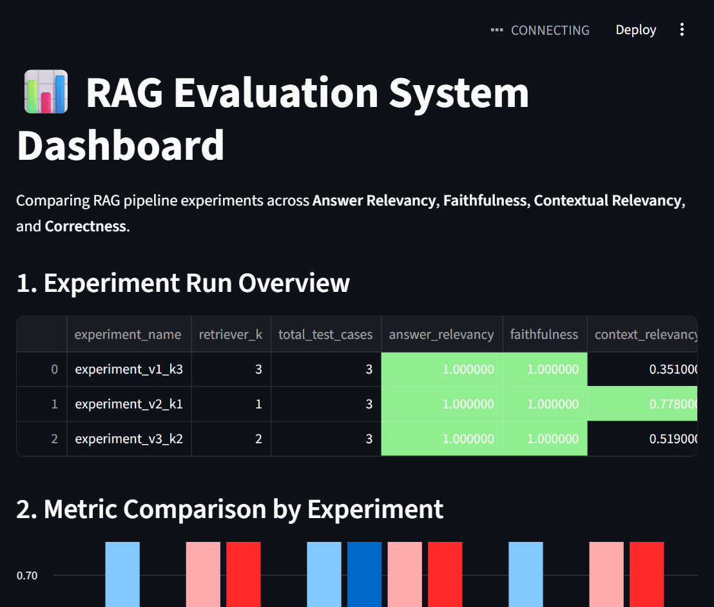

# 📊 Production RAG Evaluation System

An end-to-end evaluation harness for a LangChain-based PDF Retrieval-Augmented Generation (RAG) pipeline. This system benchmarks response quality using **DeepEval** across four core LLM metrics (**Answer Relevancy**, **Faithfulness**, **Contextual Relevancy**, and **G-Eval Correctness**) and features an interactive **Streamlit comparison dashboard**.



---

## 🎯 Problem & Purpose

Most RAG implementations rely on qualitative checks ("vibes") rather than empirical metrics. This project implements a reproducible evaluation framework to:
1. Benchmark a LangChain retrieval pipeline querying `pdfs/Penguins_ACL.pdf`.
2. Evaluate responses against a 20-question ground-truth dataset (`eval_dataset.json`).
3. Experiment with retrieval depth ($k=1$, $k=2$, $k=3$) to measure the trade-off between retrieval recall and context noise.
4. Track and visualize experiment snapshots in a real-time Streamlit dashboard.

---

## 🏗️ Architecture

```text
PDF Knowledge Base (Penguins_ACL.pdf)
        │
   [PyMuPDF] Block Extraction (file_reader.py)
        │
   [FastEmbed + InMemoryVectorStore] Document Indexing (indexing.py)
        │
   [LangChain + Groq LLM Agent] Answer Synthesis (agent.py)
        │
   Actual Answers + Retrieved Context
        │
   [DeepEval Metric Judges]
   ├── Answer Relevancy (AnswerRelevancyMetric)
   ├── Faithfulness (FaithfulnessMetric)
   ├── Contextual Relevancy (ContextualRelevancyMetric)
   └── Correctness (GEval)
        │
   JSONL Evaluation Summaries (experiment_v*.jsonl)
        │
   [Streamlit Analytics Dashboard] (dashboard.py)
```

## 📈 Empirical Benchmark Results

We benchmarked three retrieval configurations across the 20-case test dataset to evaluate the trade-off between retrieval recall and context noise:

| Experiment Run | Retriever $k$ | Answer Relevancy | Faithfulness | Context Relevancy | Correctness |
| :--- | :---: | :---: | :---: | :---: | :---: |
| `experiment_v1_k3` | 3 | **1.0000** | **1.0000** | 0.3510 | **1.0000** |
| `experiment_v2_k1` | 1 | **1.0000** | **1.0000** | **0.7780** | **1.0000** |
| `experiment_v3_k2` | 2 | **1.0000** | **1.0000** | 0.6600 | **1.0000** |

### Key Takeaway
Reducing the retriever's depth from $k=3$ to $k=1$ doubled **Context Relevancy** ($0.3510 \rightarrow 0.7780$). At $k=3$, the retriever brought in extraneous paragraphs that diluted the prompt context. Restricting to $k=1$ provided the targeted context needed to answer each prompt without any degradation to **Faithfulness** or **Correctness**.

## 🧰 Tech Stack

- **Python 3.11+** with **uv** for dependency and environment management
- **LangChain** for the RAG pipeline and **Groq** for answer generation
- **PyMuPDF** for PDF processing and **FastEmbed** for embeddings
- **DeepEval** for answer relevancy, faithfulness, contextual relevancy, and correctness metrics
- **Streamlit** for the experiment comparison dashboard

## 🚀 Quickstart

1. Install [uv](https://docs.astral.sh/uv/) and clone this repository.
2. From the repository root, install the project dependencies:

   ```sh
   uv sync
   ```

3. Create a local `.env` file from the example. In PowerShell:

   ```powershell
   Copy-Item .env.example .env
   ```

   On macOS or Linux, use `cp .env.example .env`.

4. Add your Groq API key to `.env`:

   ```dotenv
   GROQ_API_KEY=your_groq_api_key
   ```

5. Start the interactive RAG assistant:

   ```sh
   uv run main.py
   ```

   Choose **1** to ask questions about the PDF or **2** to launch the Streamlit dashboard. You can also launch the dashboard directly with `uv run streamlit run dashboard.py`.

To run the evaluation pipeline, use `uv run eval_runner1.py`, then `uv run eval_all_metrics_1.py`, followed by `uv run evaluation_summary_1.py`. The metric evaluation script currently evaluates the first three results from `results_1.json`.
